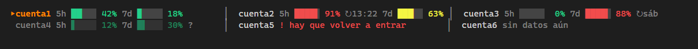

# claude-multicuenta

Ves el uso de **todas tus cuentas de Claude** a la vez, debajo del prompt de Claude Code, y
reabres todas tus conversaciones de golpe si se cierra el terminal.



Incluye dos piezas independientes:

| Pieza | Qué hace |
|---|---|
| `statusline-clauth.js` | Línea de estado de Claude Code. Muestra el % de la ventana de 5 horas y el de 7 días de cada cuenta, con su barra. |
| `warp/claude.ejemplo.yaml` | Launch Configuration de Warp. Reabre cada pestaña en su carpeta con `claude --resume <id>`. |

## Qué enseña la línea de estado

- **`▸cuenta1`** en naranja: la cuenta que está usando esta sesión.
- **`5h ██▏ 42%`** y **`7d ▉ 18%`**: el uso de cada ventana, con barras precisas a 1/8 de
  celda. Van en verde, en amarillo desde el 50 % y en rojo desde el 80 %.
- **`↻13:22`** o **`↻sáb`**: aparece al pasar del 80 % y dice cuándo se reinicia esa ventana.
- **`?`** y texto apagado: el dato es viejo porque clauth no ha podido refrescarlo.
- **`! hay que volver a entrar`**: la sesión de esa cuenta ha caducado; vuelve a entrar con
  `clauth login <cuenta>`.
- **`sin datos aún`**: la cuenta está dada de alta, pero clauth todavía no la ha consultado.
- **`⚠ clauth daemon parado…`**: el daemon no está en marcha, así que los % están congelados.

Pone de 1 a 3 cuentas por línea según el ancho del terminal, con las barras en columna.

**Privacidad.** El script no hace llamadas de red ni lee credenciales. Solo lee
`~/.clauth/status.json`, el fichero de nombres y porcentajes que mantiene `clauth daemon`.
Si ese fichero no existe, recurre a `clauth status --json`. Tarda unos 70 ms.

## Requisitos

- [Claude Code](https://claude.com/claude-code).
- Node.js 18 o superior.
- [clauth](https://github.com/uwuclxdy/clauth), que gestiona las cuentas: `cargo install clauth`.
- [Warp](https://www.warp.dev/), solo para la parte de reabrir pestañas.

## Instalación

### 1. Dar de alta las cuentas en clauth

```sh
clauth capture cuenta1                # guarda la cuenta con la que ya tienes sesión en Claude Code
clauth login cuenta2 --model opus     # abre el navegador para entrar con otra cuenta
clauth list                           # comprueba que están todas
```

> [!WARNING]
> Haz cada `clauth login` en una **ventana privada** del navegador. Si no, el navegador
> reutiliza la sesión de claude.ai que tengas abierta y das de alta otra vez la misma cuenta
> con otro nombre. Para comprobarlo, compara `~/.clauth/profiles/<cuenta>/account_id.json`
> entre perfiles.
>
> clauth guarda el modelo **por cuenta** y quita `"model"` de `~/.claude/settings.json`.
> Por eso conviene indicar `--model` al dar de alta cada cuenta.

### 2. Instalar la línea de estado

Copia `statusline-clauth.js` a `~/.claude/` y añade esto a `~/.claude/settings.json`:

```json
"statusLine": {
  "type": "command",
  "command": "node \"C:/Users/<tu-usuario>/.claude/statusline-clauth.js\"",
  "refreshInterval": 60
}
```

En Windows, escribe la ruta con barras normales (`/`). En macOS o Linux basta con
`node ~/.claude/statusline-clauth.js`.

### 3. Mantener vivo `clauth daemon`

El daemon refresca los porcentajes cada pocos minutos. En Windows no hay nada que lo
arranque solo, así que hace falta una tarea programada. Esta lo lanza al iniciar sesión y lo
vuelve a lanzar cada 5 minutos por si se ha caído (si ya está en marcha, sale sin hacer nada).
Ejecuta en PowerShell:

```powershell
$c = "$env:USERPROFILE\.cargo\bin\clauth.exe"; $u = "$env:USERDOMAIN\$env:USERNAME"
$a = New-ScheduledTaskAction -Execute "$env:WINDIR\System32\conhost.exe" -Argument "--headless `"$c`" daemon"
$t1 = New-ScheduledTaskTrigger -AtLogOn -User $u
$t2 = New-ScheduledTaskTrigger -Once -At (Get-Date).AddMinutes(1) -RepetitionInterval (New-TimeSpan -Minutes 5)
$s = New-ScheduledTaskSettingsSet -ExecutionTimeLimit ([TimeSpan]::Zero) -MultipleInstances IgnoreNew -AllowStartIfOnBatteries -DontStopIfGoingOnBatteries
Register-ScheduledTask -TaskName "clauth daemon" -Action $a -Trigger $t1,$t2 -Settings $s -User $u
```

Para comprobar que funciona, ejecuta `clauth daemon --status`. Para quitar la tarea:
`Unregister-ScheduledTask -TaskName "clauth daemon" -Confirm:$false`.

En macOS y Linux, sigue las instrucciones de clauth para dejar el daemon como servicio.

### 4. (Opcional) Reabrir las conversaciones en Warp

1. Copia `warp/claude.ejemplo.yaml` a
   `%APPDATA%\warp\Warp\data\launch_configurations\claude.yaml` y pon tus pestañas: título,
   carpeta e id de cada conversación.
2. El id de una conversación es el nombre del `.jsonl` que hay en `~/.claude/projects/<carpeta>/`.
3. Cuando se cierre Warp, ábrelo y pulsa **Ctrl+Mayús+P**, escribe `launch` y elige
   **«Claude: mis conversaciones»**.

> [!NOTE]
> Lánzalo solo con Warp recién abierto. Si las conversaciones siguen abiertas en otras
> pestañas, tendrás dos procesos escribiendo en el mismo historial.

## Ajustes

Están al principio de `statusline-clauth.js`:

| Constante | Por defecto | Qué cambia |
|---|---|---|
| `MAX_CUENTAS_POR_LINEA` | `3` | Cuántas cuentas caben como mucho en una línea. |
| `ANCHO_BARRA` | `5` | Ancho de cada barra, en celdas. |
| `AMARILLO_DESDE` | `50` | % a partir del cual el número sale en amarillo. |
| `ROJO_DESDE` | `80` | % a partir del cual sale en rojo y aparece la hora de reinicio. |

La variable de entorno `CLAUTH_SL_FEED` hace que el script lea otro `status.json`. Las
pruebas la usan para eso.

## Pruebas

```sh
node pruebas/genera.js                  # crea status.json de prueba (seis cuentas, gasto, vacío, daemon parado…)
node pruebas/ver.js seis.json 140 90    # enseña la línea de estado a 140 y a 90 columnas
node pruebas/ver.js real 120            # lo mismo con tus datos reales
```
